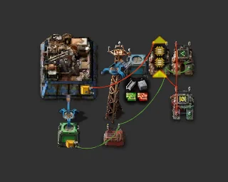

# AAI warehouse auto-crafter

> One assembler switches recipe by circuit to keep set stocks of the 6x6 warehouse and its five logistic variants.

[한국어](README.md)

<!-- AUTO:START (generated by tools/build.py, do not edit) -->



<sub>Images rendered with [Factorio Blueprint Editor](https://fbe.factorygamefan.com) (game graphics © Wube Software)</sub>

| Item | Value |
|---|---|
| Game | Factorio 2.0 (base, aai-containers) |
| Size | 7×5 tiles |
| Entities | 11 |
| Main machines | `assembling-machine-2` ×1<br>`requester-chest` ×1<br>`buffer-chest` ×1 |
| Validation | OK |

### Inputs

none

### Outputs

| Item | Per minute | Position |
|---|---:|---|
| `aai-warehouse` | - | buffer chest (refilled to 10 when below 2) |
| `aai-warehouse-passive-provider` | - | buffer chest (target 10) |
| `aai-warehouse-active-provider` | - | buffer chest (target 10) |
| `aai-warehouse-storage` | - | buffer chest (target 10) |
| `aai-warehouse-buffer` | - | buffer chest (target 10) |
| `aai-warehouse-requester` | - | buffer chest (target 10) |

### Roadmap

| Stage | When / research needed | What to do |
|---|---|---|
| 0. Research | `logistic-system` (red·green·blue·yellow), `circuit-network` (red·green), `automation-2` (red·green) | Logistic robots (requester / buffer chests), combinators and the AAI warehouse research. |
| 1. Place | - | Paste inside a robot network and connect power. With steel, concrete, green and red circuits in the network it starts with plain warehouses. |

**Build next**

- [Upgradeable mall (stackable cells)](../mall-upgradeable/README.en.md) — another mall for building items

### Files

| File | Description |
|---|---|
| [`blueprint.txt`](blueprint.txt) | default |

Copy the string to the clipboard, then in game: Blueprint library → Import string:

```sh
pbcopy < blueprints/mall-aai-warehouse/blueprint.txt   # macOS
xclip -selection clipboard < blueprints/mall-aai-warehouse/blueprint.txt   # Linux
```

### Regenerate

```sh
python3 blueprints/mall-aai-warehouse/generate.py
python3 tools/build.py mall-aai-warehouse
```

<!-- AUTO:END -->

## Layout

```
x: 0 1 2 3 4 5 6
0  A A A . . D Q    A assembler 2 (recipe set from the red wire)
1  A A A i R D Q    i fast inserter   R requester chest (fixed requests, filled by robots)
2  A A A . m . P    m marker constant combinator (what the requester asks for)
3  . o . + . . P    Q latch decider (signal L)   P arithmetic L×10 → aai-warehouse
4  . B . K . . .    o fast inserter   B buffer chest (stock)   K constant: variant targets (negative)
```

- **Requester** fixed requests (two crafts): steel 400, concrete 200, electronic circuit 40, advanced circuit 40,
  aai-warehouse 2. "Request from buffer chests" is on, so plain warehouses made here feed the variants.
- **Recipe choice**: the decider reads buffer stock + targets and outputs 1 for every short variant; the latch
  adds aai-warehouse = 10. The assembler takes the highest signal, so plain warehouses come first.
- **Latch**: on when the buffer holds fewer than 2 plain warehouses, off at 10, so the recipe switches only once
  per refill.

## Changing amounts

| What | Where | Default |
|---|---|---|
| five logistic warehouses | constant combinator K (negative) | -10 each |
| plain warehouse low / high | latch Q: `aai-warehouse < 2` / `< 10` | 2 / 10 |
| ingredient requests | requester R | two crafts |

## Notes

- Mod: AAI Containers & Warehouses. Recipes: plain warehouse = 200 steel + 100 concrete;
  logistic warehouse = 1 warehouse + 20 electronic + 20 advanced circuits.
- Place inside a robot network and connect power. Output sits in the buffer chest, ready for robot construction.
- The marker (m) shows the requester's request amounts, not per-minute rates.
- Latch condition: `(wh < 2 [green]) OR (wh < 10 [green] AND L > 0 [red])`; fix the grouping in-game if it imports differently.
